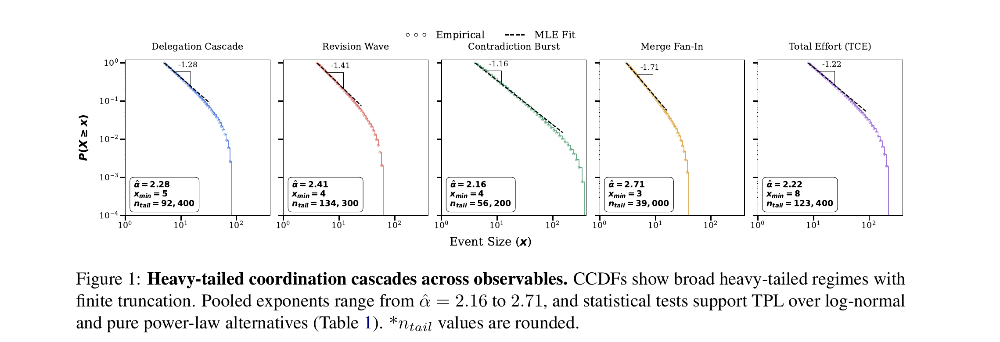
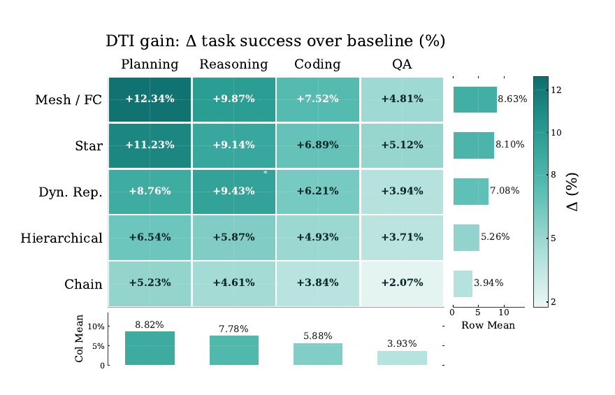

# How Coordination Scales in LLM Agent Societies:

### Heavy Tails, Reinforcement, and Concentration

[](LICENSE)
[](requirements.txt)

This repository contains the full experimental pipeline, analysis code, and
intervention (DTI) implementation for our study of coordination dynamics in
LLM multi-agent systems (MAS) — the first large-scale empirical
characterization of *how* coordination structure scales, concentrates, and
fails as agent societies grow.

<p align="center">
  
</p>

## Abstract

> LLM multi-agent systems (MAS) are increasingly deployed as interacting agent
> societies, yet scaling often yields diminishing or unstable returns whose
> cause remains poorly understood. We present the first large-scale empirical
> study of coordination dynamics in LLM multi-agent systems, introducing an
> atomic event-level formulation that reconstructs reasoning as cascades of
> coordination. Analyzing over **1.5 million interactions** across tasks,
> topologies, and scales, we uncover three coupled empirical coordination
> laws: coordination follows heavy-tailed cascades, concentrates via
> reinforced routing into influence elites, and produces increasingly large
> extreme events as system size grows. We show that these regularities are
> linked by a structural mechanism — an **integration bottleneck**, in which
> coordination expansion scales with system size while consolidation does
> not — producing the non-monotonic scaling observed in prior work. To test
> this mechanism, we introduce **Deficit-Triggered Integration (DTI)**, which
> selectively increases integration under imbalance. DTI improves
> performance precisely where coordination fails, without suppressing
> large-scale reasoning. Together, our results identify coordination
> structure as a measurable and previously underexplored axis for
> understanding and improving scalable multi-agent intelligence.

## Table of Contents

- [Key findings](#key-findings)
- [Deficit-Triggered Integration](#deficit-triggered-integration-dti)
- [Repository structure](#repository-structure)
- [Installation](#installation)
- [Quick start](#quick-start)
- [Reproducing the paper](#reproducing-the-paper)
- [Methodology at a glance](#methodology-at-a-glance)
- [Citation](#citation)
- [License](#license)

## Key findings

We decompose multi-agent reasoning into atomic coordination primitives —
**delegation**, **revision**, **contradiction**, and **merge** — reconstructed
from raw interaction traces into claim DAGs and root-centered coordination
cascades (see [Methodology](#methodology-at-a-glance)). Across **1.5M+ routed
interactions**, 7 communication topologies, 4 benchmark suites, and agent
societies of size *N* ∈ {8, ..., 512}, we find three coupled empirical laws:

| | Law | Result |
|---|---|---|
| **H1** | Coordination cascades follow **truncated power laws** | Pooled tail exponents α̂ ∈ [2.16, 2.71] across all five observables; truncated power law preferred over log-normal and pure power-law alternatives (Holm-corrected, *p* < 0.05) |
| **H2** | Coordination effort concentrates into emergent **influence elites** via reinforced routing | Top-10% of agents capture a growing excess share of coordination effort as *N* increases (up to +24 percentage points above egalitarian baseline) |
| **H3** | Extreme coordination events **grow systematically** with agent society size | Mean maximum event size scales as a power law in *N*, with the strongest growth in Total Cognitive Effort (γ̂ ≈ 0.85) |

These laws are linked by an **integration bottleneck**: expansion primitives
(delegation, contradiction) scale with system size while the integration
primitive (merge) does not, so larger societies expand reasoning faster than
they consolidate it — a structural explanation for the non-monotonic returns
to scale reported in prior MAS work.

## Deficit-Triggered Integration (DTI)

To test whether *regulating* this imbalance (rather than just adding more
agents or capability) improves outcomes, we introduce **Deficit-Triggered
Integration**: a lightweight, cascade-local intervention that monitors the
gap between expansion pressure and realized merge activity, and triggers a
forced integration step only when that deficit exceeds a condition-specific
threshold — estimated from baseline traces, with no outcome-tuned quantities.

<p align="center">
  
</p>

DTI consistently improves task success across all evaluated topology × task
conditions, with the largest gains (+12.34%) exactly where the
expansion–integration imbalance is most pronounced (Planning × Mesh/Fully
Connected), and the smallest (+2.07%) where it is weakest (QA × Chain) — a
pattern consistent with DTI regulating imbalance rather than producing
uniform, capability-driven improvements. The full algorithm lives in
[`src/dti/dti.py`](src/dti/dti.py) and is wired into the execution engine
behind a `--dti` flag (see [Quick start](#quick-start)).

## Repository structure

```
mas-powerlaws/
├── main.py                    # Root convenience entry point (this repo's pipeline)
├── src/
│   ├── topologies/            # Chain, Star, Tree/Hierarchical, Full Mesh, Sparse
│   │                          #   Mesh, Hybrid Modular, Dynamic Reputation — all
│   │                          #   subclass BaseTopology (LangGraph state machines)
│   ├── agents/                # LLMAgent — the per-agent LLM-call wrapper
│   ├── execution/              # GraphRunner (single-run) / SweepRunner (async sweep)
│   ├── event_extraction/      # Raw trace -> annotated event types (rule + LLM-assisted)
│   ├── observables/            # Claim DAG / cascade reconstruction + the 5 core observables
│   ├── tail_fitting/            # Truncated power-law MLE, boundary-aware LRT, bootstrap CIs
│   ├── dti/                    # Deficit-Triggered Integration
│   ├── metrics/                # Influence concentration (Gini, top-k share, effective N)
│   ├── benchmark_wrappers/      # GAIA / SWE-bench / REALM-Bench / MARBLE loaders + task expansion
│   ├── prompts/, context_builder.py   # Shared base prompt + topology/task addenda
│   ├── tables/, visualization/  # Result tables (LaTeX+CSV) and all 16+ result figures
│   └── analysis/                # End-to-end per-run -> pooled-fit wiring
├── scripts/
│   ├── main.py                  # All-in-one orchestrator: sweep→extract→analyse→tables→figures
│   ├── run_sweep.py, run_analysis.py, run_visualizations.py, generate_tables.py
│   │                            # Distributed-cluster workflow (one benchmark per node, see slurm/)
│   ├── run_single_agent_baseline.py, run_swe_eval.py   # Baselines / official SWE-bench scoring
│   ├── build_manifest.py, diagnose_benchmarks.py        # Setup / debugging utilities
│   └── test_pipeline.py, test_task_expander.py, smoke_test.py   # Validation (see below)
├── slurm/                       # SLURM job scripts for the distributed sweep
├── MARBLE/, REALM-Bench/        # Vendored third-party benchmark suites (not part of this codebase)
├── assets/figures/               # Figures used in this README, extracted from the paper PDF
├── claim-traces/                 # Sample raw traces + pooled analysis output (see below)
└── requirements.txt, .env.example
```

## Installation

```bash
git clone https://github.com/multiagentsystems-powerlaws/multiagentsystems-powerlaws.git
cd multiagentsystems-powerlaws

python3 -m venv venv
source venv/bin/activate
pip install -r requirements.txt

cp .env.example .env
# then fill in OPENAI_API_KEY and/or ANTHROPIC_API_KEY in .env
```

Requires Python 3.11+. `MARBLE/` and `REALM-Bench/` are vendored third-party
benchmark suites with their own dependencies — see their respective
`requirements.txt`/`pyproject.toml` if you need those benchmarks specifically.

## Quick start

**Smoke test** (stub-LLM, no API calls, validates the full pipeline in
seconds — run this first):

```bash
python scripts/test_pipeline.py --no-llm
```

**A small real run**, from the repo root:

```bash
python main.py --mode smoke --benchmark GAIA --data-root data/smoke
```

**A single sweep condition**, with more control over topology/scale/model:

```bash
python scripts/run_sweep.py \
    --benchmark GAIA --topology star --scales 32 --seeds 0 1 2 3 4 \
    --model gpt-4o-mini --data-root data/runs/GAIA
```

**With the Deficit-Triggered Integration intervention enabled:**

```bash
python scripts/run_sweep.py --benchmark GAIA --topology star --scales 128 \
    --model gpt-4o-mini --data-root data/runs/GAIA --dti
```

**Full multi-node sweep** (one benchmark per GPU node, matching `slurm/`):

```bash
python scripts/run_sweep.py --benchmark MARBLE --data-root /scratch/$USER/mas-results/MARBLE \
    --scales 8 16 32 64 128 256 512 --seeds 0 1 2 3 4
# ... repeat per benchmark/node, then:
python scripts/run_analysis.py --data-roots /scratch/$USER/mas-results/{MARBLE,GAIA,REALM,SWE-bench} \
    --out data/analysis
python scripts/run_visualizations.py --data-roots /scratch/$USER/mas-results/{MARBLE,GAIA,REALM,SWE-bench} \
    --out figures/main
python scripts/generate_tables.py --data-roots /scratch/$USER/mas-results/{MARBLE,GAIA,REALM,SWE-bench} \
    --out tables/
```

## Reproducing the paper

The experimental configuration used throughout the paper:

| Component | Setting |
|---|---|
| Benchmarks | GAIA, SWE-bench Verified, REALM-Bench, MultiAgentBench |
| Task types | QA, reasoning, coding, planning |
| Agent counts (*N*) | {8, 16, 32, 64, 128, 256, 512} |
| Topologies | Chain, Star, Hierarchical (Tree), Fully Connected, Sparse Mesh, Dynamic Reputation |
| Seeds | 5 independent repetitions per condition |
| Execution horizon | 20 steps per workflow |
| Context / completion budget | 4000 tokens / 1000 tokens |
| Primary model | GPT-4o-mini (cross-model results also reported for Qwen 2.5 72B/7B, Llama 3.1 70B) |

`src/topologies/` also includes a 7th topology, **Hybrid Modular**
(community-structured with bridge agents), which was implemented and
validated but is not part of the paper's reported topology set — it's
available for exploratory use.

Post-hoc analysis (tail fitting, DTI, tables, figures) is driven by
`scripts/run_analysis.py`, `src/tail_fitting/powerlaw_fit.py`, and
`src/tables/`/`src/visualization/`. Statistical methodology (discrete MLE
with KS-selected *x*<sub>min</sub>, boundary-aware nested LRT for
truncated-vs-pure power law, run-clustered bootstrap confidence intervals,
Holm-corrected multiple comparisons) is documented in the module docstrings
of `src/tail_fitting/powerlaw_fit.py`.

**Example data**: [`claim-traces/`](claim-traces/) contains a small sample
of real raw traces (the same GAIA task run under all 7 topologies, plus
one run per other benchmark) and the full pooled analysis output
(reconstructed claim DAG, fitted tail statistics) — see
[`claim-traces/README.md`](claim-traces/README.md) for details. The
complete trace set (~2.7GB across ~2,000 runs) is not checked into this
repository.

## Methodology at a glance

Each agent turn produces a **claim** — a unit of reasoning (proposal,
revision, contradiction, or merge) linked to its parent claim(s). The
resulting **claim DAG**, reconstructed post-hoc from raw interaction traces,
is decomposed into root-centered **coordination cascades**, over which we
define:

- **Delegation cascade** — size of the subtask subtree rooted at a `delegate_subtask` event
- **Revision wave** — length of a chain of linked `revise_claim` events
- **Contradiction burst** — number of distinct agents contradicting the same parent claim within a temporal window
- **Merge fan-in** — number of parent claims referenced by one `merge_claims` event
- **Total Cognitive Effort (TCE)** — total downstream coordination events linked to a root claim

These five observables are fit to a discrete truncated power law,
*P*(*X*=*x*) ∝ *x*<sup>−α</sup>*e*<sup>−*x*/*x*<sub>c</sub></sup>, with model
comparisons against log-normal and pure-power-law alternatives.

## Citation

This work is currently under double-blind review. A full citation will be
added here upon publication.

## License

[MIT](LICENSE) for the code in this repository. `MARBLE/` and `REALM-Bench/`
are vendored third-party benchmarks under their own respective licenses.
